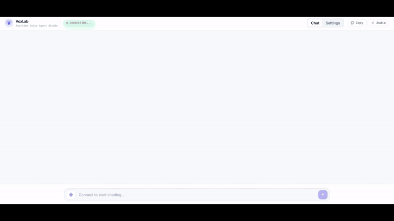

# VoxLab — Realtime Voice Agent Studio

A demonstration of advanced voice agent patterns using the **OpenAI Realtime GA API** and the **OpenAI Agents SDK**, built with **Vite + React + Tailwind CSS**.



---

## Stack

| Layer | Technology |
|---|---|
| Frontend | React 18, Vite, Tailwind CSS |
| Language | JavaScript (ES Modules) |
| Voice transport | WebRTC via `@openai/agents-realtime` |
| Realtime API | `/v1/realtime/calls` (GA API) |
| Agent SDK | `@openai/agents` v0.18+ |
| Dev server | Vite with embedded middleware (no separate Express) |

---

## Setup

1. **Install dependencies**
   ```bash
   npm install
   ```

2. **Configure environment**
   ```bash
   cp .env.sample .env
   ```
   Add your OpenAI API key to `.env`:
   ```
   OPENAI_API_KEY=sk-...
   ```

3. **Start the dev server**
   ```bash
   npm run dev
   ```

4. **Open** [http://localhost:5173](http://localhost:5173)

   The app defaults to the `chatSupervisor` agent config. You can switch scenarios in **Settings → Agent & Scenarios**.

---

## Architecture

The Vite dev server doubles as the API backend via `configureServer` middleware in `vite.config.js`. Three API routes are embedded:

| Route | Purpose |
|---|---|
| `GET /api/session` | Returns a local dev token (`ek_local_dev`) — satisfies the SDK's key format check |
| `POST /api/realtime` | Proxies the browser's WebRTC SDP offer to `POST /v1/realtime/calls?model=gpt-realtime-2.1` |
| `POST /api/responses` | Proxies guardrail classifier calls to `POST /v1/responses` |

The browser never holds a real API key — all OpenAI calls are proxied server-side.

---

## Agentic Patterns

### Pattern 1: Chat-Supervisor

Defined in `src/app/agentConfigs/chatSupervisor/`.

A realtime chat agent handles low-latency user interaction (greeting, info collection, simple responses). Complex tasks and tool calls are delegated to a high-intelligence text supervisor (`gpt-4.1`), which runs in the background and returns results to the chat agent.

```
User ──► Chat Agent (gpt-realtime-2.1)
              │  "simple tasks"
              │  responds directly
              │
              │  "complex / tool needed"
              ▼
         Supervisor (gpt-4.1)
              │  calls tools, reasons
              ▼
         returns result ──► Chat Agent ──► User
```

---

### Pattern 2: Sequential Handoffs

Defined in `src/app/agentConfigs/simpleHandoff/` and `src/app/agentConfigs/customerServiceRetail/`.

Specialized agents transfer the user between themselves based on intent. Handoffs are decided by the model via tool calls.

```javascript
import { RealtimeAgent } from '@openai/agents/realtime';

export const haikuWriterAgent = new RealtimeAgent({
  name: 'haikuWriter',
  handoffDescription: 'Agent that writes haikus.',
  instructions: 'Ask the user for a topic, then reply with a haiku about that topic.',
  tools: [],
  handoffs: [],
});

export const greeterAgent = new RealtimeAgent({
  name: 'greeter',
  handoffDescription: 'Agent that greets the user.',
  instructions: "Greet the user and ask if they'd like a haiku. If yes, hand off to haikuWriter.",
  tools: [],
  handoffs: [haikuWriterAgent],
});
```

---

### CustomerServiceRetail

A representative multi-agent customer service demo in `src/app/agentConfigs/customerServiceRetail/`:

- Agents: authentication, returns, sales, simulatedHuman (escalation)
- Uses `o4-mini` for high-stakes return eligibility decisions
- State machine prompting for structured data collection (name, phone number)

**To test:** say you'd like to return a product and follow the agent prompts.

---

## Features

### Output Guardrails

Every assistant response is checked by a classifier before display. The guardrail is defined in `src/app/agentConfigs/guardrails.js` and uses zod v4 + raw `fetch` to `/v1/responses` (zod v4 compatible). If the guardrail trips, a warning chip appears on the message bubble.

### Language Support

In **Settings → Agent & Scenarios → Language**, choose between:
- **English** — default
- **日本語 (Japanese)**

Switching language updates both the `whisper-1` transcription language and the agent's response language instruction via `session.update` — no reconnect required. To add more languages, append an entry to the `LANGUAGES` array in `src/app/components/SettingsPage.jsx`.

### Push-to-Talk vs Server VAD

In **Settings → Audio & Codec**, toggle between:
- **Server VAD** — OpenAI detects speech end automatically
- **Push to Talk** — hold the mic button in the chat dock

### Function Call Visibility

In **Settings → Agent & Scenarios → Chat Display**, toggle whether tool call breadcrumbs appear in the chat transcript.

---

## UI Overview

| Area | Description |
|---|---|
| **Header** | App name, connection status badge (click to connect/disconnect), session path, Copy and Download Audio buttons |
| **Chat tab** | Message transcript + input dock with optional PTT mic button |
| **Settings tab** | Agent scenario selector, language selector, VAD/PTT, audio codec, event logs |

---

## Adding Your Own Agent

1. Create a new file in `src/app/agentConfigs/` and define your agent(s) using `RealtimeAgent`.
2. Add the agent set to `src/app/agentConfigs/index.js`.
3. It will appear automatically in the Scenario dropdown in Settings.

For prompt guidance including state machine conventions, see `src/app/agentConfigs/voiceAgentMetaprompt.txt`.

---

## Key Files

```
src/
  app/
    App.jsx                        — main app state and session lifecycle
    agentConfigs/
      index.js                     — registers all agent sets
      chatSupervisor/              — Chat-Supervisor pattern
      customerServiceRetail/       — Sequential Handoffs pattern
      simpleHandoff/               — minimal handoff example
      guardrails.js                — output guardrail classifier
    components/
      AppHeader.jsx                — fixed nav header
      ChatPage.jsx                 — chat view
      ChatTranscript.jsx           — message list with auto-scroll
      ChatDock.jsx                 — input bar + PTT button
      SettingsPage.jsx             — settings tabs
    hooks/
      useRealtimeSession.js        — WebRTC session lifecycle
      useHandleSessionHistory.js   — transcript event handlers
    contexts/
      TranscriptContext.jsx        — transcript state
      EventContext.jsx             — event log state
vite.config.js                     — dev server + API middleware
```
